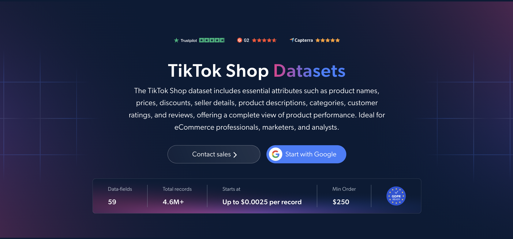

# TikTok-Shop-dataset-samples

<h2>A sample dataset of 1000 TikTok Shop products</h2>

<a href="https://brightdata.com/products/datasets/tiktok/shop">
   
</a>

A TikTok Shop dataset sample of 1000 products. Dataset was extracted using the <b>Bright Data API</b>.

<h2>Some of the data points that are included in the dataset:</h2>

* ```url```: URL of the TikTok Shop product page
* ```id```: Unique identifier for each product
* ```title```: Title of the product
* ```description```: Full description of the product
* ```brand```: Brand of the product
* ```category```: Category of the product
* ```category_tree```: Category path of the product, with names and URLs
* ```initial_price```: Original price before any discounts
* ```final_price```: Final price after discounts
* ```discount_percent```: Discount percentage applied to the product
* ```currency```: Currency of the product price
* ```sold```: Total number of units sold
* ```In_stock```: Whether the product is in stock
* ```variations```: Product variations, such as colors and sizes
* ```shipping_fee```: Shipping fee for the product
* ```prodct_rating```: Average product rating
* ```reviews_count```: Total number of customer reviews
* ```reviews```: Customer reviews of the product
* ```store_details```: Store information, including name, URL and metrics
* ```Shop_performance_metrics```: Performance metrics of the shop
* ```promotion_items```: Active promotions and offers
* ```images```: URLs of product images
* ```related_videos```: TikTok videos related to the product

And a lot more.

This is a sample subset which is derived from the "TikTok Shop (public data)"
dataset which includes more than <b>4,600,000 products</b>.

Available dataset file formats: <b>JSON, NDJSON, JSON Lines, CSV, or Parquet. Optionally, files can be compressed to .gz</b>.

Dataset delivery type options: <b>Email, API download, Webhook, Amazon S3, Google Cloud storage, Google Cloud PubSub, Microsoft Azure, Snowflake, SFTP</b>.

Update frequency: <b>Once, Daily, Weekly, Monthly, Quarterly, Biannual, or Custom basis</b>.

Data enrichment available as an addition to the data points extracted: <b>Based on request.</b>

<b>[Get the full TikTok Shop dataset](https://brightdata.com/products/datasets/tiktok/shop)</b>.

<a href="https://brightdata.com/products/datasets/tiktok/shop">
</a>

<h2>What are the TikTok Shop datasets use cases?</h2>

<h3>1. Trending products and market analysis</h3>
Businesses use TikTok Shop datasets to spot trending products and understand consumer preferences. By analyzing units sold, prices and categories, companies can assess market conditions, identify opportunities and adapt their strategies for social commerce.

<h3>2. Competitor and seller analysis</h3>
Brands analyze store details, shop performance metrics, units sold and product ratings to identify top-performing sellers on TikTok Shop. Comparing their strategies reveals opportunities for differentiation, partnerships and creator collaborations.

<h3>3. Price and discount tracking</h3>
Companies track original prices, final prices, discounts and active promotions across TikTok Shop products over time. This helps them benchmark their own pricing and time promotions to compete effectively.

<h2>Free access to web scraping tools and datasets for academic researchers and NGOs</h2>

The Bright Initiative offers access to Bright Data's <b>[Web Scraper APIs](https://brightdata.com/products/web-scraper)</b> and <b>[ready-to-use datasets](https://brightdata.com/products/datasets)</b> to leading academic faculties and researchers, NGOs and NPOs promoting various environmental and social causes. You can submit an application <b>[here](https://brightinitiative.com)</b>.
